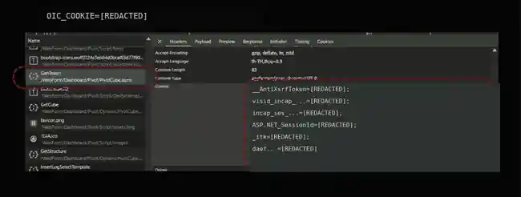

# OIC XMLA Collector

โปรแกรมสำหรับดึง **ข้อมูลสรุปสถิติประกันภัยจาก OIC Dashboard** ผ่าน XMLA แล้วบันทึกเป็นไฟล์ **Excel (.xlsx)** ใช้งานบน Windows ผ่าน Terminal UI ได้โดย **ดับเบิลคลิก `START_OIC.bat`** ไม่ต้องแก้ไขโค้ด Python

> ต้องมีบัญชีและสิทธิ์เข้าใช้งานเว็บไซต์ OIC ตามปกติ โปรแกรมนี้ไม่ใช่เครื่องมือข้ามขั้นตอน Login

## 1. เตรียมเครื่อง (ครั้งแรกครั้งเดียว)

1. ติดตั้ง [Python 3](https://www.python.org/downloads/windows/) และเลือก **Add Python to PATH** ระหว่างติดตั้ง
2. ดาวน์โหลด Repository นี้จากปุ่ม **Code → Download ZIP** บน GitHub แล้วแตกไฟล์ลงในโฟลเดอร์ที่ต้องการ
3. เปิดโฟลเดอร์โปรแกรม พิมพ์ `powershell` ในแถบที่อยู่ของ File Explorer แล้วกด Enter
4. ติดตั้งส่วนประกอบที่ใช้เปิด Terminal UI:

   ```powershell
   python -m pip install -r requirements.txt
   ```

หากคำสั่ง `python` ไม่ทำงาน ลอง `py -3 -m pip install -r requirements.txt` แทน

## 2. เข้าเว็บไซต์ OIC และเตรียมข้อมูล Session

1. เปิด [OIC Dashboard](https://onlinewebibs.oic.or.th/) ใน Google Chrome แล้ว **Login ด้วยบัญชีที่ได้รับอนุญาต**
2. เปิดหน้ารายงาน Pivot เช่น **อุบัติเหตุและสุขภาพ (AH)**
3. กด **F12** เพื่อเปิด Developer Tools → เลือกแท็บ **Network**
4. หากไม่เห็น Request ให้กด **F5** เพื่อโหลดหน้าใหม่
5. ที่ช่องค้นหาใน Network พิมพ์ **GenToken** แล้วคลิก Request ชื่อนี้

### 2.1 คัดลอก Bearer Token

เลือกแท็บ **Preview** ของ Request `GenToken` แล้วคัดลอก **ค่าของ `d` ทั้งหมด** (JWT ที่ขึ้นต้นคล้าย `eyJ...`) ไม่ต้องคัดลอก `d:` และไม่ต้องใส่คำว่า `Bearer`


### 2.2 คัดลอก Cookie

ยังอยู่ที่ Request `GenToken` เดิม → เปิดแท็บ **Headers** → เลื่อนลงไปที่ **Request Headers** → หา **Cookie** → คัดลอก **ค่าทั้งหมด** ตั้งแต่ Cookie ตัวแรกถึงตัวสุดท้าย (รวมเครื่องหมาย `;` ระหว่างค่า) ไม่ต้องคัดลอกชื่อหัวข้อ `Cookie:`



> ภาพประกอบปิดบังข้อมูลจริงแล้ว ค่า Token และ Cookie ถือเป็นข้อมูลลับที่ใช้เข้าถึง Session ห้ามส่งให้ผู้อื่นหรืออัปโหลดขึ้น GitHub

## 3. สร้างไฟล์ .env

ในโฟลเดอร์เดียวกับ `oic_collector.py` ให้คัดลอก `.env.example` เป็นไฟล์ชื่อ **`.env`** โดยเปิด PowerShell แล้วรัน:

```powershell
Copy-Item .env.example .env
notepad .env
```

ใส่ค่าที่คัดลอกจากขั้นตอนก่อนหน้าเป็น **บรรทัดเดียวต่อหนึ่งตัวแปร**:

```dotenv
OIC_BEARER_TOKEN=วางค่า_d_ที่คัดลอกมา
OIC_COOKIE=วางค่า_Cookie_ทั้งบรรทัดที่คัดลอกมา
OIC_OUTPUT_DIR=output
```

กด **Ctrl+S** เพื่อบันทึกไฟล์ ตรวจสอบว่าไฟล์ชื่อ `.env` จริง ๆ ไม่ใช่ `.env.txt` **ไม่ต้องใส่ชื่อ `Cookie:` หรือ `Bearer` นำหน้าค่า**

## 4. เปิดโปรแกรมด้วยการดับเบิลคลิก

ดับเบิลคลิก **`START_OIC.bat`** ในโฟลเดอร์โปรแกรม ระบบจะค้นหา Python และเปิด **Terminal UI** (ใช้ Windows Terminal แบบเต็มจอหากติดตั้งไว้)

> **Terminal UI เปิดได้แม้ JWT หรือ Cookie หมดอายุ** ไม่ต้องตรวจ Session ให้ผ่านก่อนจึงจะเปิดโปรแกรม

หากไม่ต้องการใช้ไฟล์ `.bat` เปิด PowerShell ในโฟลเดอร์แล้วรัน:

```powershell
python oic_collector.py
```

## 5. ใช้งานหน้า Terminal UI

1. ดูช่อง **BEARER JWT**: แสดงเวลาออก Token, เวลาหมดอายุ และเวลาคงเหลือแบบสดจากข้อมูล JWT
2. ดูช่อง **COOKIE SESSION**: โปรแกรมตรวจสอบ Session ผ่าน `GenToken` หลังเปิดหน้าจอ และตรวจเป็นระยะ
3. หากขึ้น **`SESSION_EXPIRED`** หรือ `REJECTED` ให้กลับไป Login เว็บไซต์ OIC และคัดลอก **Cookie ใหม่** ตามข้อ 2.2 แล้ววางในช่อง `OIC_COOKIE` บน Terminal UI
4. หากต้องการเปลี่ยน JWT ด้วยตนเอง ให้วางค่าใหม่ในช่อง `OIC_BEARER_TOKEN`; สถานะเวลาของ JWT จะอัปเดตทันที
5. กด **SAVE .ENV** เพื่อบันทึกค่าที่แก้ไข; กด **CHECK SESSION** เพื่อยืนยันกับเซิร์ฟเวอร์อีกครั้ง
6. เลือกประเภทข้อมูลที่ต้องการ: **AH / FI / MR / MI / MV** แล้วกด **TEST API** เพื่อลองดึงข้อมูลโดยยังไม่สร้าง Excel
7. เมื่อพร้อม กด **START COLLECTION** เพื่อดึงข้อมูลและสร้าง Excel; ติดตามผลที่ตาราง, Progress Bar และ Activity Log

เมื่อ `GenToken` สำเร็จ โปรแกรมสามารถขอ Bearer Token ใหม่และบันทึกค่าใหม่ลง `.env` ได้เอง **ตราบใดที่ Session Cookie ยังใช้งานได้** หาก Session ฝั่งเซิร์ฟเวอร์หมดอายุจริงต้อง Login ใหม่ตามปกติ

## 6. เปิดไฟล์ Excel ที่ได้

กด **OPEN OUTPUT** ใน Terminal UI หรือเปิดโฟลเดอร์ `output` เอง:

```text
onlinewebibs/
├── START_OIC.bat
├── oic_collector.py
├── requirements.txt
├── .env.example
├── .env                     ← ข้อมูลของคุณ (ห้ามอัปโหลด)
├── README.md
├── docs/
│   └── images/
│       ├── 01-bearer-token.webp
│       └── 02-cookie.webp
└── output/
    └── oic_insurance_YYYYMMDD_HHMMSS.xlsx
```

Excel มีชีตตามประเภทประกันภัยที่ดึงสำเร็จ เช่น `AH`, `FI`, `MR`, `MI`, `MV` (เป็นข้อมูลสถิติแบบสรุปจาก Cube ไม่ใช่ข้อมูลรายกรมธรรม์)

## 7. แก้ปัญหาเบื้องต้น

| อาการ | วิธีแก้ |
|---|---|
| ดับเบิลคลิก `.bat` แล้วแจ้งว่าไม่พบ Python | ติดตั้ง Python 3 และเปิดใช้งาน PATH |
| แจ้ง `No module named textual` หรือ `rich` | เปิด PowerShell แล้วติดตั้งด้วย `python -m pip install -r requirements.txt` |
| `SESSION_EXPIRED` | Login OIC ใหม่ แล้วคัดลอก **Cookie ใหม่** จาก `GenToken → Headers` |
| JWT ขึ้น `EXPIRED` แต่ Cookie ยังใช้ได้ | กด **CHECK SESSION** เพื่อขอ JWT ใหม่ผ่าน `GenToken` |
| `REJECTED` หรือ `ERROR` | ตรวจว่าคัดลอก Cookie ครบ, Login อยู่, มีสิทธิ์ใช้รายงาน และเชื่อมต่อเว็บไซต์ได้ |
| ไม่พบ Excel | ตรวจ Activity Log และดูโฟลเดอร์ในช่อง **OUTPUT DIRECTORY** |

**ข้อควรระวัง:** `.env` และ `output/` ถูกระบุใน `.gitignore` แล้ว ไม่ควร Commit Token, Cookie, ไฟล์ Session, ภาพหน้าจอที่ยังเห็นค่าจริง หรือข้อมูลที่ไม่ได้รับอนุญาตให้เผยแพร่
