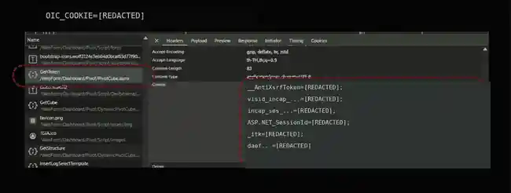

# OIC XMLA Collector

โปรแกรมสำหรับดึง **ข้อมูลสรุปสถิติประกันภัยจาก OIC Dashboard** ผ่าน XMLA แล้วบันทึกเป็นไฟล์ **Excel (.xlsx)** ใช้งานบน Windows ผ่าน Terminal UI ได้โดย **ดับเบิลคลิก `START_OIC.bat`** ไม่ต้องแก้ไขโค้ด Python

> ต้องมีบัญชีและสิทธิ์เข้าใช้งานเว็บไซต์ OIC ตามปกติ โปรแกรมนี้ไม่ใช่เครื่องมือข้ามขั้นตอน Login

## 1. เตรียมเครื่อง (ครั้งแรกครั้งเดียว)

1. ติดตั้ง [Python 3](https://www.python.org/downloads/windows/) และเลือก **Add Python to PATH** ระหว่างติดตั้ง
2. ดาวน์โหลด Repository นี้จากปุ่ม **Code → Download ZIP** บน GitHub แล้วแตกไฟล์ลงในโฟลเดอร์ที่ต้องการ
3. เปิดโฟลเดอร์โปรแกรม พิมพ์ `powershell` ในแถบที่อยู่ของ File Explorer แล้วกด Enter
4. ติดตั้งส่วนประกอบที่ใช้เปิด Terminal UI:

   ```powershell
   python -m pip install -r requirements.txt
   ```

หากคำสั่ง `python` ไม่ทำงาน ลอง `py -3 -m pip install -r requirements.txt` แทน

## 2. เข้าเว็บไซต์ OIC และเตรียมข้อมูล Session

1. เปิด [OIC Dashboard](https://onlinewebibs.oic.or.th/) ใน Google Chrome แล้ว **Login ด้วยบัญชีที่ได้รับอนุญาต**
2. เปิดหน้ารายงาน Pivot เช่น **อุบัติเหตุและสุขภาพ (AH)**
3. กด **F12** เพื่อเปิด Developer Tools → เลือกแท็บ **Network**
4. หากไม่เห็น Request ให้กด **F5** เพื่อโหลดหน้าใหม่
5. ที่ช่องค้นหาใน Network พิมพ์ **GenToken** แล้วคลิก Request ชื่อนี้

### 2.1 คัดลอก Bearer Token

เลือกแท็บ **Preview** ของ Request `GenToken` แล้วคัดลอก **ค่าของ `d` ทั้งหมด** (JWT ที่ขึ้นต้นคล้าย `eyJ...`) ไม่ต้องคัดลอก `d:` และไม่ต้องใส่คำว่า `Bearer`


### 2.2 คัดลอก Cookie

ยังอยู่ที่ Request `GenToken` เดิม → เปิดแท็บ **Headers** → เลื่อนลงไปที่ **Request Headers** → หา **Cookie** → คัดลอก **ค่าทั้งหมด** ตั้งแต่ Cookie ตัวแรกถึงตัวสุดท้าย (รวมเครื่องหมาย `;` ระหว่างค่า) ไม่ต้องคัดลอกชื่อหัวข้อ `Cookie:`



> ภาพประกอบปิดบังข้อมูลจริงแล้ว ค่า Token และ Cookie ถือเป็นข้อมูลลับที่ใช้เข้าถึง Session ห้ามส่งให้ผู้อื่นหรืออัปโหลดขึ้น GitHub

## 3. สร้างไฟล์ .env

ในโฟลเดอร์เดียวกับ `oic_collector.py` ให้คัดลอก `.env.example` เป็นไฟล์ชื่อ **`.env`** โดยเปิด PowerShell แล้วรัน:

```powershell
Copy-Item .env.example .env
notepad .env
```

ใส่ค่าที่คัดลอกจากขั้นตอนก่อนหน้าเป็น **บรรทัดเดียวต่อหนึ่งตัวแปร**:

```dotenv
OIC_BEARER_TOKEN=วางค่า_d_ที่คัดลอกมา
OIC_COOKIE=วางค่า_Cookie_ทั้งบรรทัดที่คัดลอกมา
OIC_OUTPUT_DIR=output
```

กด **Ctrl+S** เพื่อบันทึกไฟล์ ตรวจสอบว่าไฟล์ชื่อ `.env` จริง ๆ ไม่ใช่ `.env.txt` **ไม่ต้องใส่ชื่อ `Cookie:` หรือ `Bearer` นำหน้าค่า**

## 4. เปิดโปรแกรมด้วยการดับเบิลคลิก

ดับเบิลคลิก **`START_OIC.bat`** ในโฟลเดอร์โปรแกรม ระบบจะค้นหา Python และเปิด **Terminal UI** (ใช้ Windows Terminal แบบเต็มจอหากติดตั้งไว้)

> **Terminal UI เปิดได้แม้ JWT หรือ Cookie หมดอายุ** ไม่ต้องตรวจ Session ให้ผ่านก่อนจึงจะเปิดโปรแกรม

หากไม่ต้องการใช้ไฟล์ `.bat` เปิด PowerShell ในโฟลเดอร์แล้วรัน:

```powershell
python oic_collector.py
```

## 5. Five-Cube Field Catalog และ Dedicated Query Designer

หลัง Session ผ่าน Main Terminal จะค้นหา Field Catalog ของ AH/FI/MR/MI/MV แบบ AGGREGATE_FY ทีละหมวด โดยยังไม่เริ่มเก็บสถิติ

- GetStructure ให้ CAPTION และกลุ่ม มุมมอง/ข้อมูล ตาม OIC
- GET_MENUTEMPLATE_LIST กับ XMLA Metadata ให้หลักฐานจับคู่ MDX Identifier
- แสดง CAPTION ต้นฉบับทุกภาษา ไม่แปล ไม่เปลี่ยนชื่อ
- Cache อยู่ใน output/catalog/AH.json, FI.json, MR.json, MI.json, MV.json
- UNVERIFIED คือไม่มี Mapping พอใช้ส่ง Query; UNSUPPORTED คือ Calculation/Filter ที่ยังไม่รองรับ
- Discovery ไม่ใช่หลักฐานว่า XMLA Execute ผ่านทุกรายการ

กด **OPEN QUERY DESIGNER** เพื่อเปิด Textual Window แยกจาก Main Terminal โดย Main ยังทำงานต่อ

1. เลือก Insurance Category AH/FI/MR/MI/MV
2. เลื่อนดู Tree ที่แบ่ง GROUP_DIMENSION → DIMENSION → CAPTION หรือค้นหา CAPTION, DATAFIELD, DATATABLE และ MDX
3. คลิกฟิลด์ในกลุ่มมุมมอง แล้วกด A เพื่อเพิ่ม X = ROWS หรือ S เพื่อเพิ่ม Y = COLUMNS (มีปุ่ม + X / + Y)
4. คลิกฟิลด์ในกลุ่มข้อมูลเพื่อเปิด/ปิด Measure ใน VALUES; เลือกหลายรายการได้
5. เพิ่มหลายฟิลด์ต่อแกน เลือกจาก Dropdown แล้วกด ↑/↓/× เพื่อจัดลำดับหรือลบ
6. ปรับ WORKERS (เริ่มต้น 4), X CHUNK (1), Y CHUNK (20)
7. กด PREVIEW เพื่อแสดง MDX ในเครื่อง ไม่ส่ง API
8. กด APPLY SELECTION เพื่อบันทึก Query และปิด Designer; Main อ่านค่าอัตโนมัติ

กด CANCEL แล้วไม่เปลี่ยน Query เดิม ขณะพิมพ์ Search ปุ่ม A/S ทำงานเป็นตัวอักษรปกติ

เมื่อ Cache ยังเป็น PROFILE/UNVERIFIED สามารถ REFRESH CATALOGS จาก Main หรือ RELOAD CATALOG จาก Designer ได้ โดยไม่ดึงสถิติ

## 6. สามหน้าต่างระหว่าง Collection

กด START COLLECTION จาก Main หลัง Apply เท่านั้น จึงเริ่มดึงข้อมูล

| Window | Function |
|---|---|
| Main Terminal | Authentication, Query Summary, Start/Stop/Resume |
| Rich Live Monitor | Run ID, Worker/HTTP Status, Heartbeat, Chunk Summary |
| Worker Terminal | หนึ่ง Windows Terminal พร้อม N Tabs ตาม Worker Count |

**schema_version=2:** X = ROWS = MDX Axis1 และ Y = COLUMNS = MDX Axis0; Measures อยู่บน Axis1 เพื่อรักษา CellOrdinal Mapping

Run รุ่นเก่าใช้ Semantics เดิมอย่างแยกเวอร์ชัน ไม่ใช้ Raw XML/Chunk ที่ตีความแกนคนละแบบมารวมกัน

เลือกหลาย Dimensions ใช้ MDX CrossJoin จริง ซึ่งอาจหนักต่อ OIC แนะนำเริ่มทดสอบ 1 Worker ก่อนเพิ่ม Concurrency

## 7. Raw XML / Excel / Stop / Resume

~~~text
output/
  catalog/
    AH.json, FI.json, MR.json, MI.json, MV.json
  query_selection.json
  oic_parallel/
    RUN_ID/
      query_config.json
      job_plan.json
      master_manifest.json
      worker_01/
        state.json
        heartbeat.json
        manifest.json
        chunks/
          CHUNK.request.xml
          CHUNK.response.xml
      worker_02/ ...
      excel/
        selected_query.xlsx
~~~

- Raw XML ถูกบันทึกก่อน Excel
- Excel เป็น Long Format เก็บทุก X/Y Member กับ Measure ตาม CellOrdinal
- STOP ให้ Workers หยุดรับ Chunk ใหม่หลัง Request ปัจจุบัน
- ปิด Monitor ไม่หยุด Workers
- RESUME ใช้ Query Config เดิมและข้าม XML Chunk ที่ Valid แล้ว
- หากบาง Chunk ล้มเหลว Excel INFO แสดง PARTIAL

เปิด Run เดิมหรือ Export ซ้ำจาก PowerShell:

~~~powershell
python oic_parallel_collector.py --query-config "output/oic_parallel/RUN_ID/query_config.json" --launch
python oic_parallel_collector.py --query-config "output/oic_parallel/RUN_ID/query_config.json" --export-only
~~~

## 8. Manual Validation และ Troubleshooting

~~~powershell
python -m compileall -q oic_collector.py oic_query.py oic_parallel_collector.py
python -c "import oic_collector, oic_query, oic_parallel_collector; print('IMPORT OK')"
python oic_collector.py
~~~

| อาการ | แนวทาง |
|---|---|
| Portable Python Isolated Import ไม่พบ | ตรวจ python314._pth และ Project Directory ของ Interpreter ที่ใช้งานจริง |
| SESSION_EXPIRED | Login OIC ด้วยบัญชีที่ได้รับอนุญาต แล้วตั้ง Cookie ใหม่ |
| JWT Expired | กด CHECK SESSION เพื่อเรียก GenToken |
| GetStructure HTTP Error | เปิดจาก Cache แล้ว Refresh ภายหลัง |
| UNVERIFIED | มีชื่อจาก OIC แต่ยังจับคู่ MDX ที่รองรับไม่ได้ |
| UNSUPPORTED | Calculation/Display Mode ยังไม่รองรับ ห้าม Export ตัวเลขผิด |
| HTTP 500/503 | ลด CrossJoin/Chunk Size และเริ่มจาก Worker เดียว |
| Monitor STALE | ตรวจ Worker Tabs/Heartbeat |
| Excel PARTIAL | ตรวจ Worker Manifest และ Raw XML |

**ข้อจำกัด:** Live Metadata และการเปิด Windows Terminal 3 Windows ต้องตรวจด้วย Windows และ Session จริง; Offline Checks ไม่ใช่หลักฐานว่า Extract ครบทั้ง 5 Cube ทุก Combination

ห้าม Commit .env, JWT, Cookie, Headers, Session, Network Dump หรือ Raw XML; โปรแกรมไม่สร้าง Web UI/Database/Queue และไม่ควบคุม Chrome


## All-dimension collection: round-robin paged plan

The Main Collector remains the entry point. REFRESH CATALOG, CHECK VERIFIED
and REFRESH MEMBER use the existing web-only catalog and member inventory.
Use JOB PLAN to generate deterministic round-robin jobs and exact member/year
pages locally. No HTTP calls, benchmark or new member discovery are needed
for a complete compatible inventory. A previous full-first plan is preserved:
the paged preparation copies inventory within the same SQLite database.
Previously committed full-first requests do not count as completed paged requests.

Defaults: 4 workers, 1 year and 20 members per request, all supported native
measures, 60-second collection timeout and 1-second delay. All HTTP sessions
use curl_cffi. START COLLECTION uses the worker count saved in the plan.

```powershell
python -m pip install -r requirements.txt
python oic_collector.py
# Alternatively, use the shared CLI:
python oic_parallel.py --prepare
python oic_parallel.py
python oic_parallel.py --status
python oic_parallel.py --export-only
# Optional custom plan (changes create a separate preparation when needed):
python oic_parallel.py --prepare --workers 2 --years-per-request 1 --members-per-request 20 --timeout 60 --delay 1
python oic_parallel.py --workers 2
```

During collection, workers save raw XML and SQLite checkpoints only; they
never open or write Excel. After all workers finish, or after STOP/Ctrl+C
and graceful worker shutdown, the supervisor rebuilds a single consolidated
workbook from all committed raw responses in the current preparation:

`output/oic_all_dim/excel/<preparation>/OIC_DATA_001.xlsx`

DATA contains all categories, year types, hierarchies, years, members and
a common set of measure columns; INFO records aggregate-data metadata.
Only when DATA exceeds 1,048,575 data rows (plus its header) is the next
workbook created. Resume retains the same plan and checkpoints; the next
export replaces the consolidated snapshot rather than appending duplicates.
`python oic_parallel.py --export-only` rebuilds it offline after workers stop.
Existing per-request Excel files from older versions are not deleted.
No new job plan, member refresh or HTTP request is needed for this export.
The original oic_parallel.py script is available in Git history at 6c17a7e;
the current CLI delegates to oic_all_dim.py instead of maintaining a second engine.
