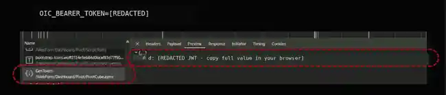

# OIC XMLA Collector

โปรแกรมสำหรับดึง **ข้อมูลสรุปสถิติประกันภัยจาก OIC Dashboard** ผ่าน XMLA แล้วบันทึกเป็นไฟล์ **Excel (.xlsx)** ใช้งานบน Windows ผ่าน Terminal UI ได้โดย **ดับเบิลคลิก `START_OIC.bat`** ไม่ต้องแก้ไขโค้ด Python

> ต้องมีบัญชีและสิทธิ์เข้าใช้งานเว็บไซต์ OIC ตามปกติ โปรแกรมนี้ไม่ใช่เครื่องมือข้ามขั้นตอน Login

## 1. เตรียมเครื่อง (ครั้งแรกครั้งเดียว)

1. ติดตั้ง [Python 3](https://www.python.org/downloads/windows/) และเลือก **Add Python to PATH** ระหว่างติดตั้ง
2. ดาวน์โหลด Repository นี้จากปุ่ม **Code → Download ZIP** บน GitHub แล้วแตกไฟล์ลงในโฟลเดอร์ที่ต้องการ
3. เปิดโฟลเดอร์โปรแกรม พิมพ์ `powershell` ในแถบที่อยู่ของ File Explorer แล้วกด Enter
4. ติดตั้งส่วนประกอบที่ใช้เปิด Terminal UI:

   ```powershell
   python -m pip install -r requirements.txt
   ```

หากคำสั่ง `python` ไม่ทำงาน ลอง `py -3 -m pip install -r requirements.txt` แทน

## 2. เข้าเว็บไซต์ OIC และเตรียมข้อมูล Session

1. เปิด [OIC Dashboard](https://onlinewebibs.oic.or.th/) ใน Google Chrome แล้ว **Login ด้วยบัญชีที่ได้รับอนุญาต**
2. เปิดหน้ารายงาน Pivot เช่น **อุบัติเหตุและสุขภาพ (AH)**
3. กด **F12** เพื่อเปิด Developer Tools → เลือกแท็บ **Network**
4. หากไม่เห็น Request ให้กด **F5** เพื่อโหลดหน้าใหม่
5. ที่ช่องค้นหาใน Network พิมพ์ **GenToken** แล้วคลิก Request ชื่อนี้

### 2.1 คัดลอก Bearer Token

เลือกแท็บ **Preview** ของ Request `GenToken` แล้วคัดลอก **ค่าของ `d` ทั้งหมด** (JWT ที่ขึ้นต้นคล้าย `eyJ...`) ไม่ต้องคัดลอก `d:` และไม่ต้องใส่คำว่า `Bearer`



### 2.2 คัดลอก Cookie

ยังอยู่ที่ Request `GenToken` เดิม → เปิดแท็บ **Headers** → เลื่อนลงไปที่ **Request Headers** → หา **Cookie** → คัดลอก **ค่าทั้งหมด** ตั้งแต่ Cookie ตัวแรกถึงตัวสุดท้าย (รวมเครื่องหมาย `;` ระหว่างค่า) ไม่ต้องคัดลอกชื่อหัวข้อ `Cookie:`


> ภาพประกอบปิดบังข้อมูลจริงแล้ว ค่า Token และ Cookie ถือเป็นข้อมูลลับที่ใช้เข้าถึง Session ห้ามส่งให้ผู้อื่นหรืออัปโหลดขึ้น GitHub

## 3. สร้างไฟล์ .env

ในโฟลเดอร์เดียวกับ `oic_collector.py` ให้คัดลอก `.env.example` เป็นไฟล์ชื่อ **`.env`** โดยเปิด PowerShell แล้วรัน:

```powershell
Copy-Item .env.example .env
notepad .env
```

ใส่ค่าที่คัดลอกจากขั้นตอนก่อนหน้าเป็น **บรรทัดเดียวต่อหนึ่งตัวแปร**:

```dotenv
OIC_BEARER_TOKEN=วางค่า_d_ที่คัดลอกมา
OIC_COOKIE=วางค่า_Cookie_ทั้งบรรทัดที่คัดลอกมา
OIC_OUTPUT_DIR=output
```

กด **Ctrl+S** เพื่อบันทึกไฟล์ ตรวจสอบว่าไฟล์ชื่อ `.env` จริง ๆ ไม่ใช่ `.env.txt` **ไม่ต้องใส่ชื่อ `Cookie:` หรือ `Bearer` นำหน้าค่า**

## 4. เปิดโปรแกรมด้วยการดับเบิลคลิก

ดับเบิลคลิก **`START_OIC.bat`** ในโฟลเดอร์โปรแกรม ระบบจะค้นหา Python และเปิด **Terminal UI** (ใช้ Windows Terminal แบบเต็มจอหากติดตั้งไว้)

> **Terminal UI เปิดได้แม้ JWT หรือ Cookie หมดอายุ** ไม่ต้องตรวจ Session ให้ผ่านก่อนจึงจะเปิดโปรแกรม

หากไม่ต้องการใช้ไฟล์ `.bat` เปิด PowerShell ในโฟลเดอร์แล้วรัน:

```powershell
python oic_collector.py
```

## 5. Query Designer: เลือกมุมมองเอง

**ค่าเริ่มต้นใหม่: ไม่ดึง Hierarchies ทั้งหมดโดยอัตโนมัติ** ต้องเลือกมุมมองและกด Start เองก่อน

1. ที่ Insurance Category เลือก **AH / FI / MR / MI / MV** หนึ่งหมวด
2. ใช้ Field Explorer ค้นหาชื่อไทย อังกฤษ หรือ MDX Identifier (ค้นหาจาก Local Catalog ไม่ยิง API ทุกครั้ง)
3. คลิก Dimension แล้วกด **A** เพื่อย้ายไป X (แนวนอน) หรือ **S** เพื่อย้ายไป Y (แนวตั้ง)
4. เมื่อพิมพ์ใน Search ปุ่ม A/S จะพิมพ์ข้อความ ไม่เปลี่ยนแกน
5. เลือก Measure ด้วยการคลิกรายการใน Field Explorer เพื่อเปิด/ปิด VALUES
6. ใช้ Dropdown X/Y และปุ่ม X ↑/↓/REMOVE หรือ Y ↑/↓/REMOVE เพื่อเรียง/ลบ Field
7. ปรับ **WORKERS** (เริ่มต้น 4), **X CHUNK** (1) และ **Y CHUNK** (20)
8. กด **PREVIEW QUERY** เพื่อดู MDX ในเครื่อง โดยยังไม่ส่ง Request
9. เมื่อ Session ใช้งานได้ กด **START COLLECTION**

โปรแกรมโหลด Field Catalog จากโปรไฟล์เดิมหรือแคชที่ output/catalog/CODE.json และมีปุ่ม REFRESH CATALOG เพื่ออ่าน XMLA Metadata โดยใช้ Session ที่ได้รับอนุญาต แสดง Source และไม่ถือว่าทุกฟิลด์ผ่านการทดสอบ Execute แล้วเพียงเพราะพบชื่อใน Metadata

**MR:** YEAR ยังไม่ได้ยืนยันจาก Response ที่สำเร็จ จึงต้อง Refresh/เลือก YEAR จาก Metadata จริง ไม่เดาชื่อจาก MV หรือ Cube อื่น

## 6. Windows Terminal: 3 หน้าต่าง

| หน้าต่าง | หน้าที่ |
|---|---|
| 1. Query Designer | Textual UI หลัก ยังเปิดอยู่ระหว่างรัน |
| 2. Live Monitor | Rich Monitor อ่านสถานะจริงจาก State/Heartbeat/Manifest |
| 3. Worker Terminal | Windows Terminal หนึ่งหน้าต่าง พร้อม Tabs ตามจำนวน Workers |

Workers ใช้ requests.Session แยกกัน และรับ X Member Chunks ที่ไม่ซ้ำ โดยแต่ละ Worker จะดึง Y Member Chunks ต่อเนื่องตาม Query ที่ผู้ใช้เลือกจริง

**ข้อควรระวัง:** Multi-Dimension CrossJoin อาจใช้เวลานาน ควรทดสอบมุมมองเล็กด้วย 1 Worker ก่อน และเพิ่มจำนวน Workers เมื่อบริการ OIC พร้อมใช้งาน

## 7. Raw XML / Excel / Stop / Resume

แต่ละ Start มี Run ID และแยก Output ไม่ให้ปะปนกัน:

~~~text
output/
  catalog/
    AH.json, FI.json, MR.json, MI.json, MV.json
  oic_parallel/
    RUN_ID/
      query_config.json
      job_plan.json
      master_manifest.json
      worker_01/
        state.json
        heartbeat.json
        manifest.json
        chunks/
          CHUNK.request.xml
          CHUNK.response.xml
      worker_02/ ...
      excel/
        selected_query.xlsx
~~~

Raw XML ถูกเก็บก่อนแปลง Excel เสมอ Excel เป็น Long Format เพื่อรักษาความสัมพันธ์ X/Y/VALUES สำหรับหลายมิติ หากบาง Chunk ล้มเหลว ชีต INFO จะระบุ PARTIAL

**STOP** จาก Query Designer จะส่งสัญญาณให้ Workers หยุดรับงานใหม่ หลังจัดการ Request ที่กำลังทำอยู่

**RESUME** จาก Query Designer ใช้ Query เดิมและข้าม Chunk ที่มีไฟล์ XML ถูกต้องแล้ว หากกลับมาใช้งานภายหลัง ให้เปิด PowerShell ในโฟลเดอร์โปรแกรมและสั่ง:

~~~powershell
python oic_parallel_collector.py --query-config "output/oic_parallel/RUN_ID/query_config.json" --launch
~~~

หากหยุด Run เดิมด้วยปุ่ม STOP ต้องลบ stop.flag ในโฟลเดอร์ Run ก่อน Resume ทาง CLI (ปุ่ม RESUME ใน UI จัดการให้)

ส่งออก Excel ซ้ำจาก Raw XML โดยไม่ยิง OIC:

~~~powershell
python oic_parallel_collector.py --query-config "output/oic_parallel/RUN_ID/query_config.json" --export-only
~~~

การปิด Monitor ไม่หยุด Workers แต่ต้องสั่ง --export-only ภายหลังหากไม่ได้ปล่อย Monitor ไว้จนจบงาน

## 8. Troubleshooting และ Tests

~~~powershell
python -m compileall -q oic_collector.py oic_parallel_collector.py oic_query.py
python -m unittest discover -s tests -v
python oic_collector.py --test-only
~~~

| ปัญหา | วิธีดำเนินการ |
|---|---|
| Python / textual / rich / openpyxl ไม่พร้อม | python -m pip install -r requirements.txt |
| SESSION_EXPIRED | Login เว็บ OIC ใหม่และอัปเดต Cookie ของตนเอง |
| JWT EXPIRED | กด CHECK SESSION เพื่อขอ GenToken ใหม่ |
| HTTP 500/503 | ตรวจความพร้อมของ Backend และลดขนาด Query ไม่เพิ่ม Workers เพื่อแก้ 503 |
| MR ไม่มี X Default | Refresh Metadata และเลือก YEAR ที่ยืนยันได้จริง |
| Monitor STALE | ตรวจ Worker Heartbeat และ Worker Tab ไม่สรุปว่า Completed |
| Excel PARTIAL | ดู Worker Manifest ว่า Chunk ใดขาด |

ข้อมูลทั้งหมดเป็น **OLAP Aggregate** ไม่ใช่ข้อมูลกรมธรรม์หรือเคลมรายธุรกรรมดิบ

**ความปลอดภัย:** ห้าม Commit .env, Cookie, JWT, Session, Raw Dataset หรือ Screenshot ที่มีค่า Credential จริง ทั้ง .env และ output/ อยู่ใน .gitignore

**ข้อจำกัด:** การเปิดหน้าต่าง Windows และ Live XMLA ของ AH/FI/MR/MI/MV ต้องทดสอบด้วย Windows และ Session ที่ได้รับอนุญาต ผล Offline Tests ไม่เทียบเท่าการยืนยัน Live ทุก Cube
